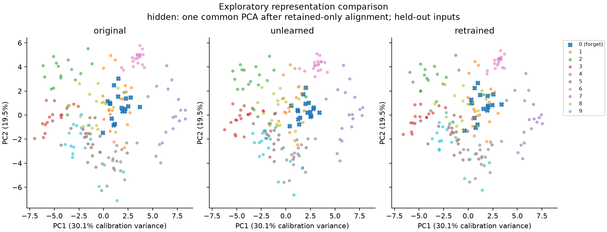
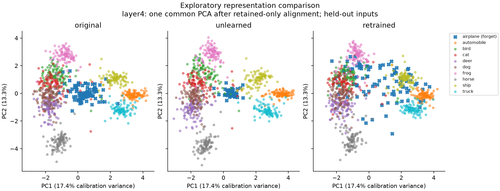

# Laptop representation pilot — 2026-11-05

The CPU pipeline is implemented and has been run on the three archived
digit-0 checkpoint trios, seeds 0, 1, and 2. No training, GPU, fault injection,
or dataset download was needed. The desktop run below extends the analysis to
actual ResNet-18 checkpoints on CIFAR-10.

## What was compared

Each trio contains the original model, the incorrect-label suppression model
named `unlearned` in the archives, and a retained-only retrained model. We
extract the 64-dimensional hidden ReLU activation before the classifier.

The analysis uses shared images and keeps three disjoint groups:

- Up to 60 original training images per digit, for training-record diagnostics.
- The archived discovery split for held-out comparisons: 180 images per seed,
  including 18, 17, and 18 digit-0 images respectively.
- Retained images from the selection split for fitting the visualization's
  orthogonal alignment and common PCA axes. These do not enter metric estimates.

The archived test split was not used. Discovery and selection data were already
used in previous experiments, making this an exploratory analysis.

## Observations

Debiased linear CKA on held-out digit-0 examples:

| Seed | n | Original / unlearned | Original / retrained | Unlearned / retrained |
|---|---:|---:|---:|---:|
| 0 | 18 | 0.9512 | 0.9708 | 0.9223 |
| 1 | 17 | 0.9302 | 0.9793 | 0.9014 |
| 2 | 18 | 0.9508 | 0.9510 | 0.9579 |

Shared 10-neighbor fractions for held-out digit-0 anchors, with all 180
held-out images as the candidate pool:

| Seed | Original / unlearned | Original / retrained | Unlearned / retrained |
|---|---:|---:|---:|
| 0 | 0.9167 | 0.9278 | 0.8778 |
| 1 | 0.8941 | 0.8588 | 0.8059 |
| 2 | 0.8944 | 0.8889 | 0.8778 |

In seed 0, original digit-0 recall is 100%, while unlearned and retrained recall
are both 0%. All three have 96.91% retained accuracy on these held-out images.
Despite equal forget recall, unlearned and retrained predictions disagree on
72.22% of the forgotten examples: matching one behavioral metric does not imply
matching the output distribution, either.

All three pairs show similar hidden geometry. In particular, the retrained
model is also close to the original. Therefore, high original/unlearned
similarity alone cannot identify unsuccessful unlearning. CKA and neighbor
overlap also do not always rank the pairs identically. The results establish a
working diagnostic pipeline, not a universal signature of residual knowledge.

The axes are common across the three panels. Forgotten digit-0 examples are
marked with crosses. Calibration PCA explains about 49.6% of calibration
variance in two dimensions for seed 0, so substantial geometry remains unseen.
Calibration rank is below 64 for these ReLU features; rotations outside the
calibration span are underdetermined. See each `plot_diagnostics.json`.

## Evidence and reproduction

Each seed now has **one unified report** covering behavior, CKA and neighbors,
class-average similarities, raw/centered changes, and PCA. The separate digit
and relations report series have been removed. The raw numerical comparisons
are exactly preserved after consolidation.

For seed 0, mean similarity between **distinct zero images** is 0.9592 in the
original, 0.9539 in the suppressed model, and 0.9431 after retraining. Mean
zero/one similarity changes from 0.5995 to 0.7413 and 0.6728 respectively. Thus
the zero representations remain coherent while their angular relationships
with other classes change. These are descriptive values on the same small
held-out set; they do not establish memorization or a causal mechanism.

- [Seed 0 report](seed0/REPORT.md), [metrics](seed0/metrics.json).
- [Seed 1 report](seed1/REPORT.md), [metrics](seed1/metrics.json).
- [Seed 2 report](seed2/REPORT.md), [metrics](seed2/metrics.json).
- [Compact cross-seed values](summary.json).
- [Setup, exact commands, metrics, and desktop handoff](../../docs/representation-analysis.md).

Every per-seed folder includes CSV tables, three PNG figures, and provenance
with source checkpoint/reference hashes. Portable feature bundles are in the
ignored local `runs/representations/digit0-seed{seed}/features.npz` paths and can
be regenerated from the archived weights. Git transfers the reports and code
only after the new files are added through the usual workflow.

## Origin sensitivity

The unified report now computes the centering and Euclidean checks directly,
replacing the one-off `centering-check.json` calculation. For retained-class
pairs, mean cosine changes after suppression are:

| Seed | Raw mean change | Centered mean change | Centered mean absolute change |
|---|---:|---:|---:|
| 0 | +0.0456 | +0.0025 | 0.0237 |
| 1 | +0.0851 | +0.0025 | 0.0228 |
| 2 | +0.0729 | +0.0004 | 0.0254 |

Centering uses each model's retained calibration mean. The broadly positive
raw change becomes mixed after centering, but nonzero differences remain.
Signed means can cancel, and centering constrains aggregate geometry; this
is not proof that a common offset explains everything. Mean Euclidean
separation among different retained classes decreases about 5–12% after
suppression, a scale-sensitive observation rather than evidence of erasure.

Validation: fourteen consolidated representation tests cover metric invariants,
class summaries, retained-only centering, artifact integrity, and single- and
multiple-layer report generation. Original metrics and raw class cosines were
compared against the previous reports and match exactly in all three seeds.
The figures were inspected visually. Desktop CPU extraction is now validated;
CUDA extraction remains untested because the NVIDIA driver was unavailable.

## Limits and next experiment

There are only 17–18 held-out forget examples per seed. Scores are descriptive,
without confidence intervals or an equivalence threshold. Original and retrained
models share an initialization seed, and the existing seeds change data splits.
These three configurations cannot estimate pure retrain/retrain variability.

Add independently retrained models on an identical fixed retained dataset, and
repeat the ResNet analysis across configurations. Confirm that the original/retrained difference is detectable
before interpreting original/unlearned similarity. Repeat with a validated
published unlearning method before extending conclusions beyond suppression.

## Desktop ResNet-18 pilot

The [seed 0 report](resnet-seed0/REPORT.md) and its figures, tables, numerical
metrics and provenance are tracked alongside the digits results. The existing
original, incorrect-label suppression, and retained-only retrained checkpoints
were evaluated on the same CIFAR-10 inputs. The held-out search split contains
100 airplane (forget) and 900 retained examples; 900 retained selection examples
fit alignment and PCA. These previously used splits make the analysis exploratory.

The airplane cloud is compact in the original and suppressed models, but spreads
across the plot in the retrained model. Retained class clouds look broadly similar.
This visible contrast is more pronounced than in the digits pilot and is a useful
hypothesis for further study. The shared axes and orthogonal alignment are fitted
on retained calibration examples; the two axes explain 30.7% of calibration
variance, so the picture alone cannot establish full-space separation or erasure.

Full-space metrics also show a layer-dependent difference. For held-out airplane
examples, original/suppressed debiased CKA falls from 0.9996 at layer1 to 0.5396
at layer4; original/retrained and suppressed/retrained layer4 values are 0.3572
and 0.2169. Corresponding shared 10-neighbor fractions at layer4 are 0.400,
0.122, and 0.115. On retained examples, layer4 debiased CKA is 0.9716, 0.9382,
and 0.9149 respectively. These measures capture different aspects of geometry,
and none alone establishes successful unlearning.

Airplane accuracy falls from 97% in the original to 0% in both other models;
the latter two still disagree on 60% of airplane predictions. Retained accuracy
is 94.78%, 95.44%, and 94.33%, respectively. This is one checkpoint trio, with
no fixed-split independent retraining controls or uncertainty estimates; differences
cannot yet be attributed uniquely to suppression versus retraining variability.

Validation used PyTorch on CPU: all 28 repository tests passed, as did a synthetic
ResNet smoke extraction and analysis and the real checkpoint extraction. CUDA was
unavailable because the NVIDIA driver could not be contacted. The feature bundle
remains in ignored `runs/`; tracked outputs include the generated report and its
supporting artifacts.
