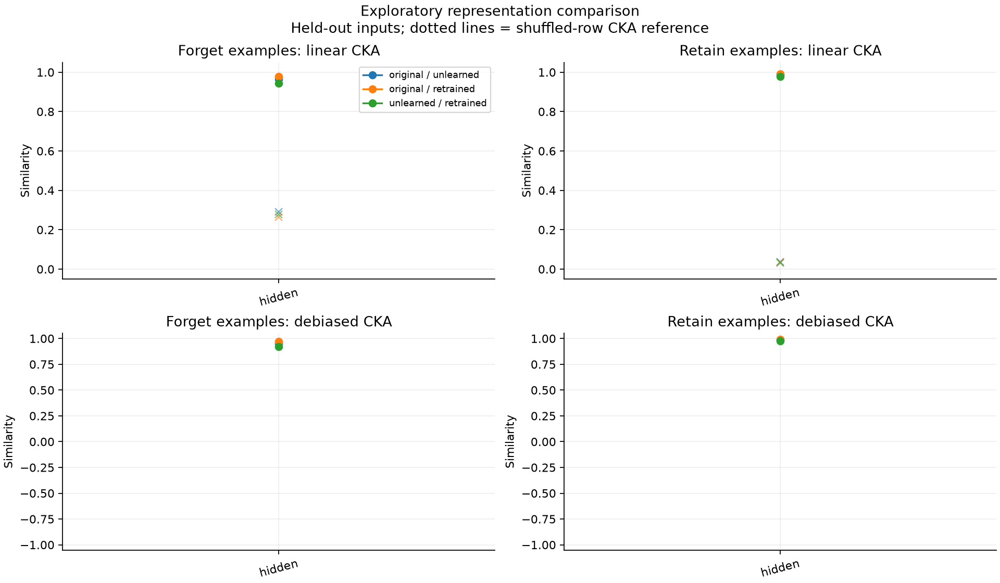
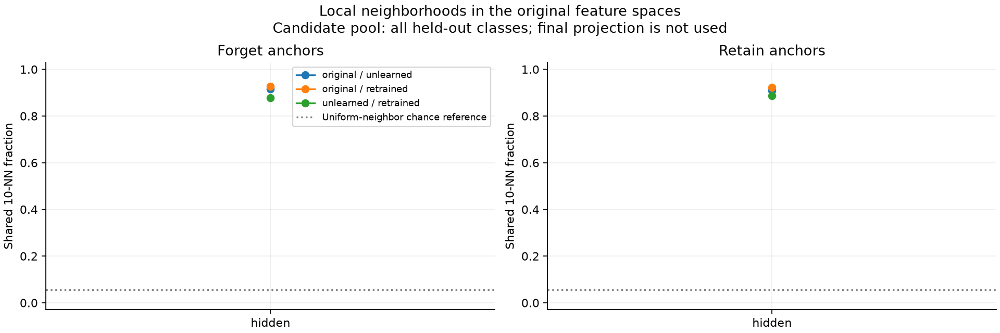
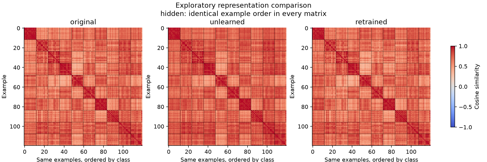
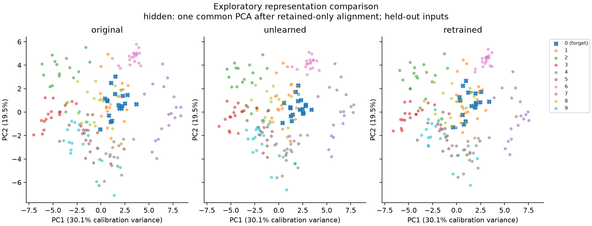

# Representation diagnostics

Source: **archived_digits**. incorrect-label suppression baseline.

- Exploratory: archived splits/checkpoints were used in earlier experiments.
- No independent retrain replicate in this fixture; no erasure claim.
- Selection split retained examples calibrate PCA; excluded from metrics.
- CKA uses separately centered groups; kNN uses all classes in each partition.
- Permutation means diagnose finite-sample bias; they are not p-values.
- No confidence interval or equivalence claim from a single model trio.
- Debiased CKA uses unbiased HSIC; its ratio is not an unbiased estimator.
- Cosine ties use input row order; inspect neighbor_quality for degeneracy.

## Held-out comparisons

| Layer | Group | Pair | n | CKA | Debiased CKA | Permuted CKA |
|---|---|---|---:|---:|---:|---:|
| hidden | forget | original--unlearned | 18 | 0.9660 | 0.9512 | 0.2903 |
| hidden | retain | original--unlearned | 162 | 0.9884 | 0.9881 | 0.0363 |
| hidden | forget | original--retrained | 18 | 0.9790 | 0.9708 | 0.2634 |
| hidden | retain | original--retrained | 162 | 0.9926 | 0.9924 | 0.0336 |
| hidden | forget | unlearned--retrained | 18 | 0.9430 | 0.9223 | 0.2785 |
| hidden | retain | unlearned--retrained | 162 | 0.9784 | 0.9778 | 0.0331 |

## Figures

Calibration and PCA limitations are recorded in `plot_diagnostics.json`.
Full class-specific and training-example results are in `comparisons.csv` and `metrics.json`.
