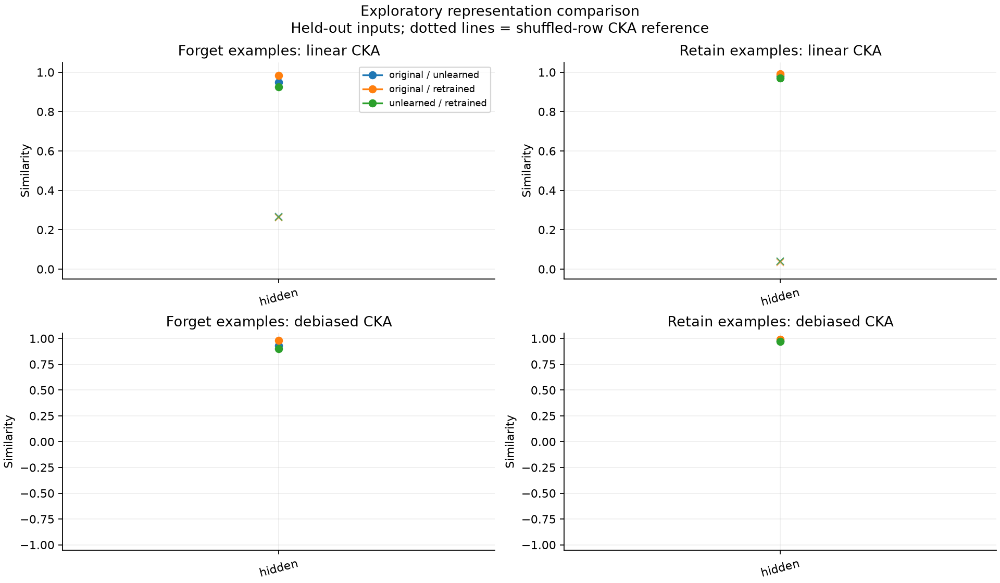
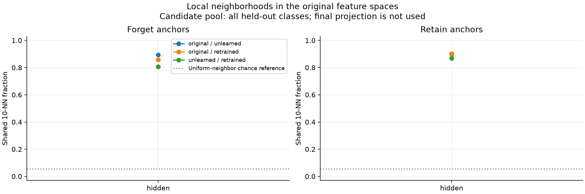
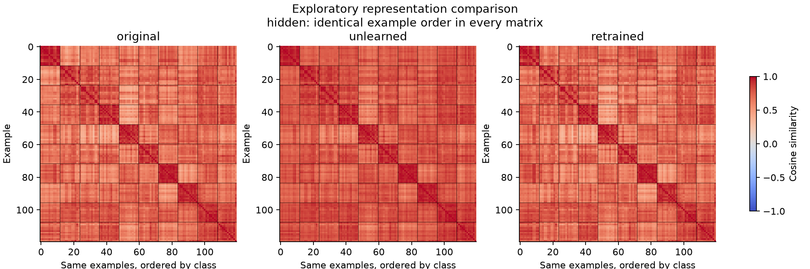
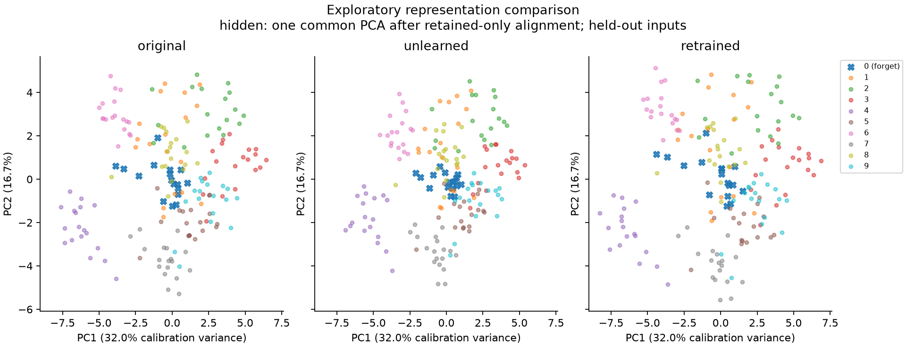

# Representation diagnostics

Source: **archived_digits**. incorrect-label suppression baseline.

- Exploratory: archived splits/checkpoints were used in earlier experiments.
- No independent retrain replicate in this fixture; no erasure claim.
- Selection split retained examples calibrate PCA; excluded from metrics.
- CKA uses separately centered groups; kNN uses all classes in each partition.
- Permutation means diagnose finite-sample bias; they are not p-values.
- No confidence interval or equivalence claim from a single model trio.
- Debiased CKA uses unbiased HSIC; its ratio is not an unbiased estimator.
- Cosine ties use input row order; inspect neighbor_quality for degeneracy.

## Held-out comparisons

| Layer | Group | Pair | n | CKA | Debiased CKA | Permuted CKA |
|---|---|---|---:|---:|---:|---:|
| hidden | forget | original--unlearned | 17 | 0.9489 | 0.9302 | 0.2682 |
| hidden | retain | original--unlearned | 163 | 0.9795 | 0.9789 | 0.0406 |
| hidden | forget | original--retrained | 17 | 0.9825 | 0.9793 | 0.2612 |
| hidden | retain | original--retrained | 163 | 0.9922 | 0.9920 | 0.0349 |
| hidden | forget | unlearned--retrained | 17 | 0.9240 | 0.9014 | 0.2643 |
| hidden | retain | unlearned--retrained | 163 | 0.9707 | 0.9698 | 0.0409 |

## Figures

Calibration and PCA limitations are recorded in `plot_diagnostics.json`.
Full class-specific and training-example results are in `comparisons.csv` and `metrics.json`.
