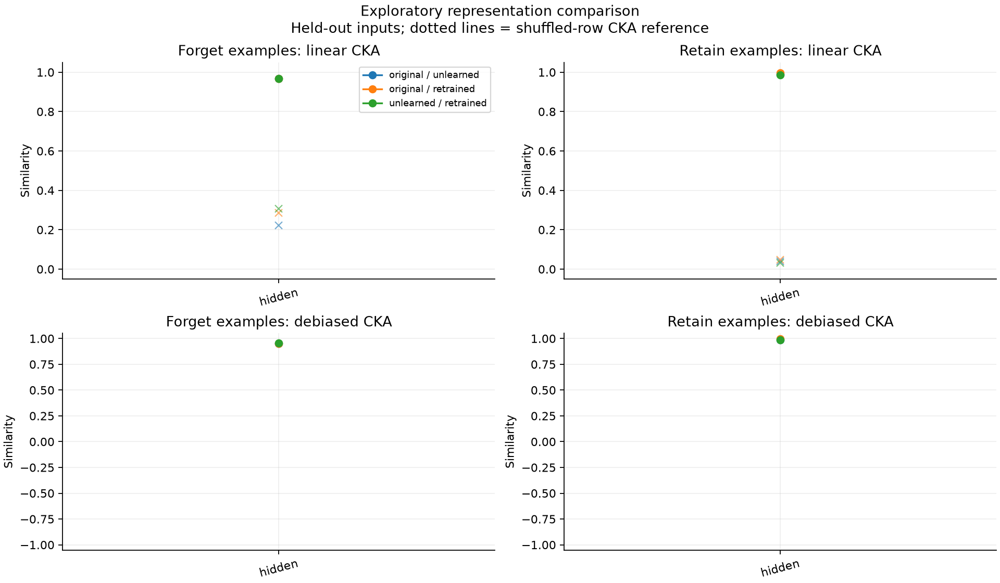
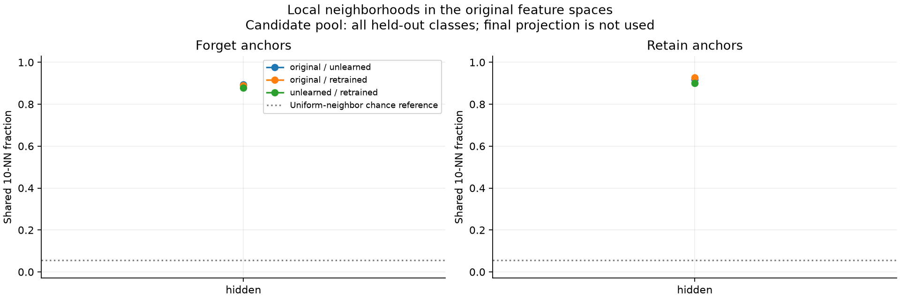
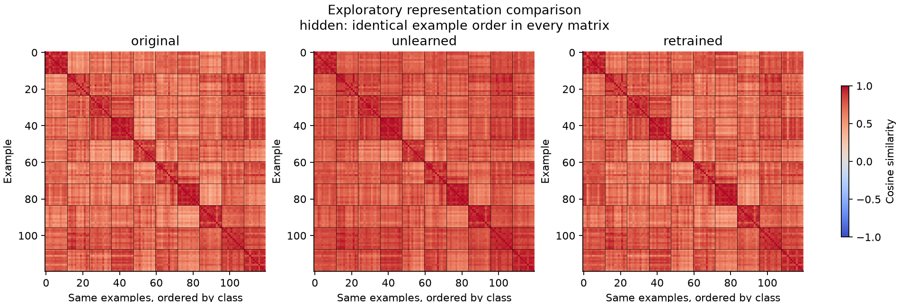
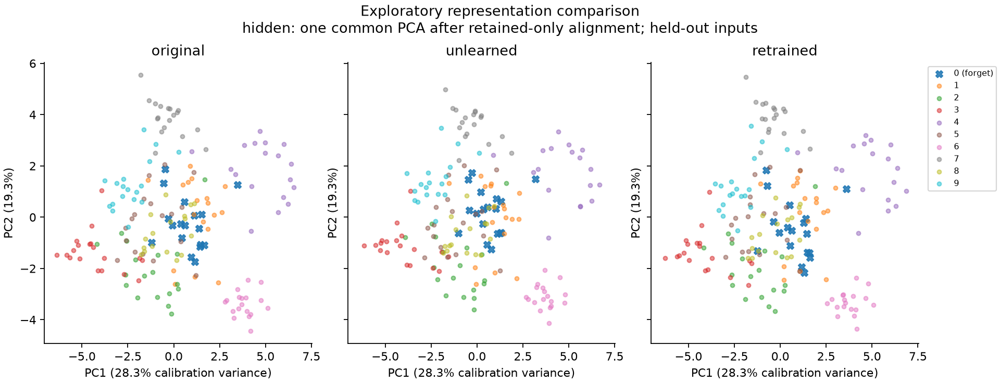

# Representation diagnostics

Source: **archived_digits**. incorrect-label suppression baseline.

- Exploratory: archived splits/checkpoints were used in earlier experiments.
- No independent retrain replicate in this fixture; no erasure claim.
- Selection split retained examples calibrate PCA; excluded from metrics.
- CKA uses separately centered groups; kNN uses all classes in each partition.
- Permutation means diagnose finite-sample bias; they are not p-values.
- No confidence interval or equivalence claim from a single model trio.
- Debiased CKA uses unbiased HSIC; its ratio is not an unbiased estimator.
- Cosine ties use input row order; inspect neighbor_quality for degeneracy.

## Held-out comparisons

| Layer | Group | Pair | n | CKA | Debiased CKA | Permuted CKA |
|---|---|---|---:|---:|---:|---:|
| hidden | forget | original--unlearned | 18 | 0.9669 | 0.9508 | 0.2222 |
| hidden | retain | original--unlearned | 162 | 0.9879 | 0.9875 | 0.0399 |
| hidden | forget | original--retrained | 18 | 0.9679 | 0.9510 | 0.2865 |
| hidden | retain | original--retrained | 162 | 0.9960 | 0.9958 | 0.0467 |
| hidden | forget | unlearned--retrained | 18 | 0.9675 | 0.9579 | 0.3059 |
| hidden | retain | unlearned--retrained | 162 | 0.9866 | 0.9861 | 0.0330 |

## Figures

Calibration and PCA limitations are recorded in `plot_diagnostics.json`.
Full class-specific and training-example results are in `comparisons.csv` and `metrics.json`.
