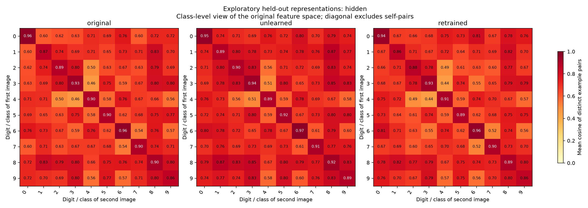
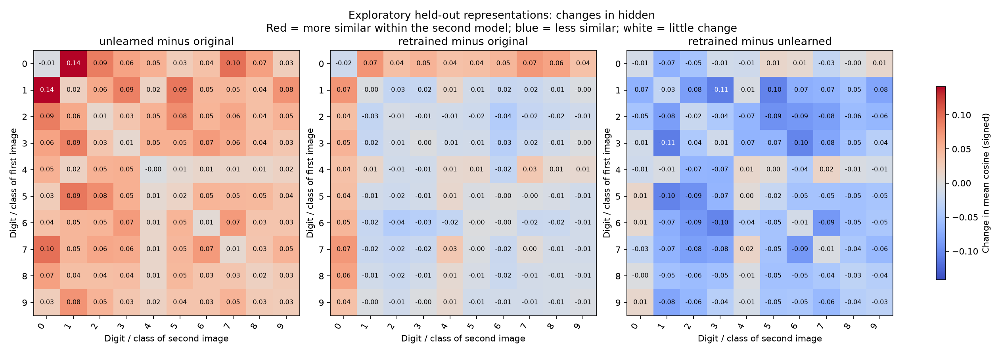
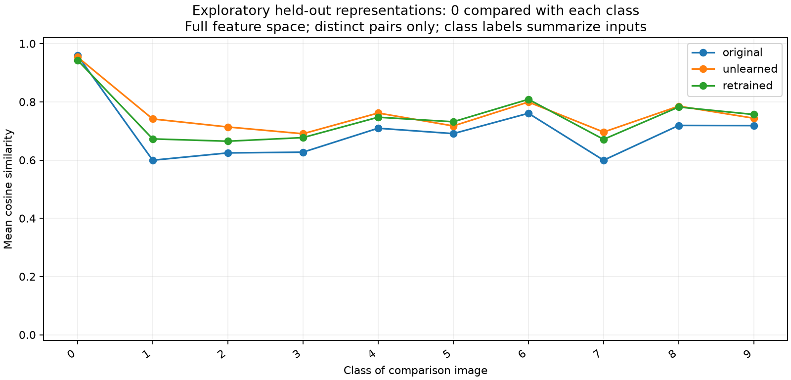

# Another view of the representation

Source: archived_digits; layer: hidden; forgotten class: 0.

These views use the full activations with no fitted alignment or dimensionality reduction.

## Reading the original similarity.png

Each panel is one model. Rows and columns identify the same sequence of input images,
ordered by true class, with up to 12 images per class. A cell compares those two images
within that model, not one neuron or one pair of models. The scale is shared across panels.

Cosine similarity is the dot product divided by the product of vector lengths.
+1 means the same direction, 0 means perpendicular, and -1 means opposite directions.
The self-comparison diagonal is 1 for nonzero features and provides no forgetting evidence.
Raw ReLU features are nonnegative, so their cosine cannot be negative: mostly red panels
are expected. The old scale included -1 for generality. Cosine ignores vector magnitude.

A dark same-class square means examples of that class have similar activation directions.
An off-diagonal square compares two classes. Compare the same cell across panels to see
whether that relationship changes. The matrix is symmetric; mirrored cells repeat information.

## Class summaries

Each cell now averages all held-out image pairs from its row and column classes.
The diagonal compares different examples of the same class, excluding trivial self-matches.
The raw ReLU view uses a shared 0-to-1 scale. Class averages can hide variation.

## Changes between models

Each title specifies second model minus first model. Red means that the example pairs
became more similar; blue means less similar. This color scale shows a change, not raw cosine.
The scale is shared among panels within this figure, but may differ across run folders.

## Forgotten-class relationships

This traces the forgotten-class row of the class summary. It can reveal whether the class
stays coherent while its relationships to other classes change. These are geometry summaries,
not class probabilities, evidence of memorization, or confidence intervals.
