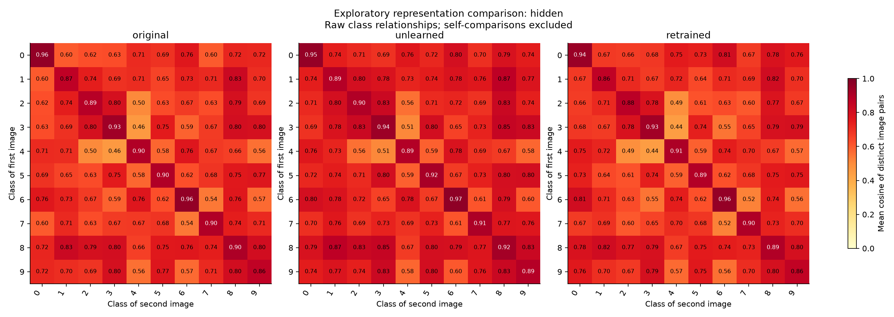
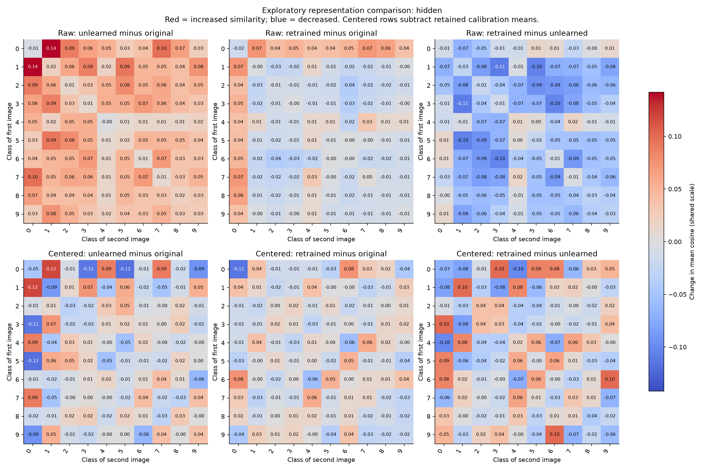
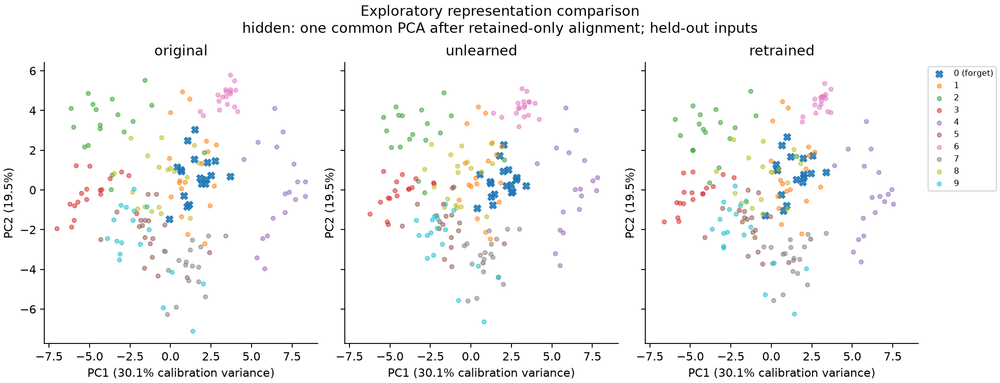

# Representation comparison

Source: **archived_digits**; seed: **0**; forget class: **0**. incorrect-label suppression baseline.

- Exploratory: archived splits/checkpoints were used in earlier experiments.
- No independent retrain replicate in this fixture; no erasure claim.
- Selection split retained examples calibrate PCA; excluded from metrics.

## Behavior on held-out inputs

| Model | Group | n | Accuracy | NLL |
|---|---|---:|---:|---:|
| original | forget | 18 | 100.00% | 0.0002 |
| original | retain | 162 | 96.91% | 0.0892 |
| unlearned | forget | 18 | 0.00% | 5.5871 |
| unlearned | retain | 162 | 96.91% | 0.0915 |
| retrained | forget | 18 | 0.00% | 13.2720 |
| retrained | retain | 162 | 96.91% | 0.0899 |

## Representation metrics

These metrics use unreduced activations before any fitted alignment. Higher values mean
more similar geometry or neighborhoods, not better unlearning. CKA is centered within
each group; neighbor candidates include all classes in the partition.

| Layer | Group | Pair | n | CKA | Debiased CKA | Shuffled CKA | Shared 10-NN | Prediction disagreement |
|---|---|---|---:|---:|---:|---:|---:|---:|
| hidden | forget | original--unlearned | 18 | 0.9660 | 0.9512 | 0.2903 | 0.9167 | 100.00% |
| hidden | retain | original--unlearned | 162 | 0.9884 | 0.9881 | 0.0363 | 0.9086 | 1.23% |
| hidden | forget | original--retrained | 18 | 0.9790 | 0.9708 | 0.2634 | 0.9278 | 100.00% |
| hidden | retain | original--retrained | 162 | 0.9926 | 0.9924 | 0.0336 | 0.9235 | 0.62% |
| hidden | forget | unlearned--retrained | 18 | 0.9430 | 0.9223 | 0.2785 | 0.8778 | 72.22% |
| hidden | retain | unlearned--retrained | 162 | 0.9784 | 0.9778 | 0.0331 | 0.8864 | 1.23% |

## Class relationships

Cosine and PCA views use **hidden**. Each heatmap cell averages similarities between
images of its row and column classes. Diagonal cells compare distinct images of the same
class, excluding self-matches. Cosine measures direction, ignoring magnitude. ReLU features
are nonnegative, so raw cosines cannot be negative. Class means can hide variation.

## Changes and sensitivity to centering

Columns show the model subtraction in their titles. Red means increased cosine similarity;
blue means decreased similarity. Raw and centered rows share one signed color scale.
Centering subtracts each model mean on retained calibration examples only. The mean is not
fitted on these held-out images. No rotation or projection is used for these heatmaps.

| Coordinates | Model difference | Mean change among retained classes | Mean absolute change | Positive / valid pairs |
|---|---|---:|---:|---:|
| raw | unlearned minus original | 0.0456 | 0.0456 | 36 / 36 |
| raw | retrained minus original | -0.0111 | 0.0153 | 5 / 36 |
| raw | retrained minus unlearned | -0.0567 | 0.0578 | 2 / 36 |
| centered | unlearned minus original | 0.0025 | 0.0237 | 18 / 36 |
| centered | retrained minus original | -0.0004 | 0.0185 | 16 / 36 |
| centered | retrained minus unlearned | -0.0029 | 0.0339 | 14 / 36 |

Signed means may cancel; centering also constrains aggregate geometry. Disappearance
of a broad signed increase does not prove that changes were entirely a common offset.

| Model | Mean Euclidean distance between retained classes | Mean retained activation norm |
|---|---:|---:|
| original | 9.3036 | 11.7961 |
| unlearned | 8.3878 | 11.5058 |
| retrained | 8.6237 | 10.7492 |

Euclidean distances weight image pairs equally and are sensitive to scale. Pair counts
are not independent statistical samples; these comparisons are descriptive.

## PCA overview

Two axes explain **49.6%** of calibration variance. Rotations/reflections and PCA
are fitted on retained calibration examples only. A similar 2D position is not full-space equivalence.

- Orthogonal maps and common PCA fitted only on retained calibration rows.
- No labels are used to fit PCA or rotations; labels color the display.
- A 2D projection can hide changes; numerical metrics use full feature spaces.
- Calibration is rank-deficient: rotations outside its span are underdetermined.

## Limits and numerical evidence

- CKA uses separately centered groups; kNN uses all classes in each partition.
- Permutation means diagnose finite-sample bias; they are not p-values.
- No confidence interval or equivalence claim from a single model trio.
- Debiased CKA uses unbiased HSIC; its ratio is not an unbiased estimator.
- Cosine ties use input row order; inspect neighbor_quality for degeneracy.

A retrained model may retain a coherent forget-class representation through shared features.
High similarity alone cannot demonstrate residual training-data influence. Compare against
independent retraining on fixed retained data before claiming equivalence or removal.

All results and provenance are in [metrics.json](metrics.json). Detailed tables:
[comparisons](comparisons.csv), [behavior](behavior.csv), [class relations](relations.csv).
[Plot diagnostics](plot_diagnostics.json) record calibration rank and alignment residuals.
